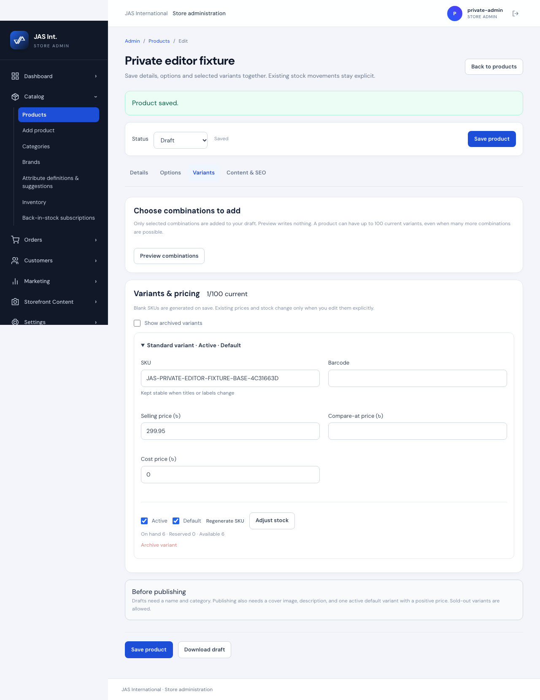
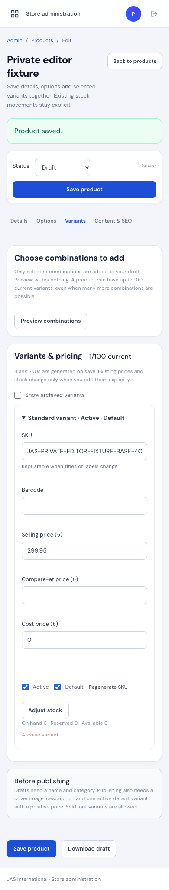
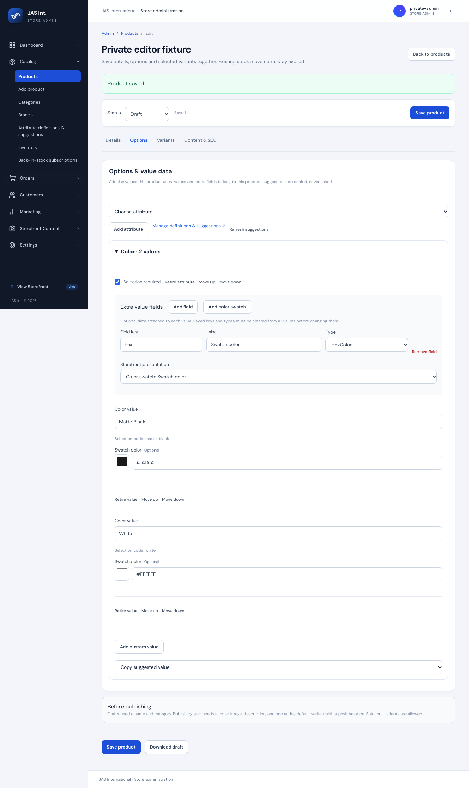

# Product editor v2 validation

The release was checked from an isolated checkout, excluding unrelated cart, header, homepage and storage edits in the working directory. Browser scripts remain private and are absent from the repository and CI.

| Requirement | Evidence |
|---|---|
| Unified draft, mixed edits and busy-state recovery | `MixedOptionAndVariantChangesRemainSaveableAndValidationRetainsDraft`; private cold Server/warm WebAssembly saves without blurring |
| Atomic draft/publish, opening stock, replay and stale editors | `DraftNeedsOnlyNameCategoryAndCreatesNoPlaceholderVariant`, `AtomicPublishWithOpeningStockIsReplaySafeAndRecoveryReturnsReceipt`, `FailedVariantValidationRollsBackProductAndOpeningStock`, `ConcurrentCatalogSavesHaveOneWinnerAndDetailsPreserveIdentifiersPricesStock` |
| Selective preview and current-variant cap | `SparsePickerPagesHugeUnsavedMatrixWithoutWritingAndAddsOnlySelected` previews 10,000 theoretical rows without writes; `VariantCapIncludesInactiveRowsAndDuplicateCombinationsAreRejected` |
| Ownership, restoration and retirement | `ForeignOptionIdsAndNormalizedDuplicateValuesNeverPartiallySave`, `ArchivedMatchesRequireExplicitRestorationAndRetiredValuesPreserveSelections` |
| Stable SKUs and collisions | `AutomaticSkuIsReadableBoundedAndUsesStableClientIdentity`, `SkuCollisionIsCaseInsensitiveIncludesArchivedAndRequiresExplicitResolution` |
| Typed metadata and copied templates | `MetadataHasNativeTypesAndOnlyConfiguredColorIsPublic`, `InvalidMetadataAndSchemaAreRejected`, `GlobalMetadataCopiesWithoutChangingExistingProductCopies`, `ProductMetadataIsIndependentAndLabelsDoNotChangeCodesOrSku` |
| Independent stock concurrency and ledger | `StockUsesXminReservationsAndIndependentCatalogRevisionWithIdempotentLedger` |
| Shopping consistency and unavailable choices | `VariantDiscountFlowsToDetailsCatalogCartAndFeed`, `MissingCombinationKeepsChoiceAndShowsNaWithoutStockAlert`, `ZeroStockVariantKeepsRealPriceAndAlertButMissingCombinationHasNeither` |
| Session, real antiforgery and compatibility | `EditorRequiresCurrentAdministratorRealAntiforgeryAndNoStore`, `LegacyMutationContractsReturnEditorUpdatedWithoutWriting` |
| Populated migration preservation and collision refusal | `EditorV2Migration_PreservesIdentitiesSelectionsReservationsAndOrderSnapshots`, `EditorV2Migration_StopsOnLegacySkuCollisionsUntilExplicitlyResolved` |
| Rich text, drag/drop and saved textarea values | `ProductCreation_RequiredRichEditorAndDropUploadsArePresentOnMainForm`; private browser formatting/no-blur saves and draft navigation |

Release build: zero warnings, zero errors. Native TUnit results: **92 unit + 35 SEO + 140 PostgreSQL integration = 267 passed**, zero failures/skips. Release publish includes WebAssembly assembly trimming. EF reports no pending model changes. NuGet transitive dependency and npm audits report no vulnerabilities. CSS generation uses explicit application source folders, excluding transient build/test output, and is reproducible before/after builds.

An isolated PostgreSQL 16 staging database was migrated and smoke-tested over HTTPS using the published application in Production mode. Both cold Server and warm WebAssembly editing were exercised, including numeric/rich-text changes without blur, SEO preview, stock adjustments, navigation between products, mobile width, validation failures and reconciliation after a committed response was deliberately lost. No real customer records or real mail delivery were used. The historical migration roundtrip preserves variant/option IDs, SKU/barcode, pricing, on-hand/reserved stock and order/item snapshots; a separate test proves legacy SKU collisions stop the migration until explicitly resolved.

